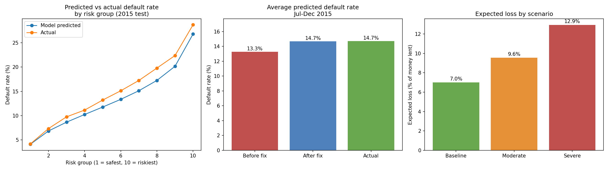

# Credit Risk Model: Probability of Default on Lending Club Loans

Predicts which borrowers will default, then estimates expected loss (PD x LGD x EAD) and stress-tests it.

Data: Lending Club accepted loans, 2007-2018 (https://www.kaggle.com/wordsforthewise/lending-club). Not included here because of its size.

## Method
- Default = Charged Off or Default. Loans still running were excluded (outcome unknown).
- Sample: 36-month loans only, trained on 2012-2014 (306,462 loans), tested out-of-time on 2015 (283,026 loans). 60-month loans were excluded because their outcomes are incomplete.
- Only information known at application was used. Post-loan columns (recoveries, repayments, last payment date) were kept out of the PD model to avoid data leakage.
- Models: logistic regression (main) and Random Forest (benchmark).

## Results
- Test AUC 0.658, Gini 0.317, KS 0.229. Random Forest AUC 0.661, so no meaningful gain.
- Model drift: 2015 defaults ran above predictions (14.9% actual vs 13.3% predicted). Recalibrating on Jan-Jun 2015 gave 14.7% predicted vs 14.7% actual on Jul-Dec 2015.
- LGD about 87%. Expected loss 7.0% vs 7.3% actual on Jul-Dec 2015.
- Stress test: expected loss rose 36% (moderate) and 85% (severe).

[View the Power BI dashboard (PDF)](Lending%20Club%20Credit%20Risk%20Dashboard-Powerbi.pdf)

## Limitations
- Stress shocks (income, DTI, FICO, LGD) are my assumptions, not official scenarios.
- Recalibration used outcomes that would not yet have been known in real time.
- LGD ignores interest never received, so it is simplified.
- Location and other protected-characteristic proxies were left out on purpose.

## Files
- credit-risk-default.ipynb: full analysis
- results.png: charts
- pbi_results.xlsx: data behind the Power BI dashboard
- Lending Club Credit Risk Dashboard-Powerbi.pdf: Power BI dashboard
